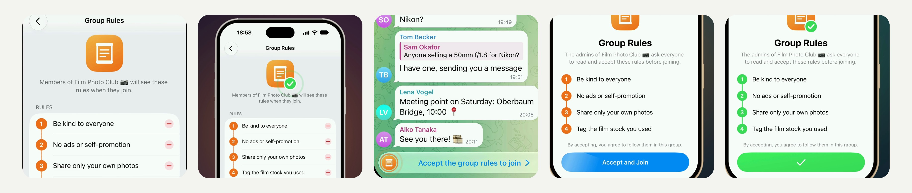

# Group Rules - admins set rules, new members accept them before joining (iOS)

Big groups need rules, and today they get lost in a pinned message nobody opens. With **Group Rules**, admins write the
rules in the group's settings and can ask new members to accept them. Whoever taps **Join** sees the rules first and
joins by accepting them; closing them turns Join into a bar that brings them back.

[](Media/group-rules.mp4)

▶︎ [Media/group-rules.mp4](Media/group-rules.mp4) - the feature in the iOS Simulator (2160×2160, 60 fps, 28 s, loops).

Pure UIKit and Telegram's own components (list items, the glass panels, the input panels), no new dependencies, no
server changes. 24 files, +3422 −12: two new modules, two new files in the chat, and hooks in existing files. Builds
with the project's own `Make.py build` (`debug_sim_arm64`).

## How it works

- **For admins.** Edit a group: **Group Rules** sits among its settings, with how many rules there are (or Off). Its
  scroll icon unrolls and its title writes itself the first times it is seen; once members have to accept the rules,
  a green seal sits on the scroll.
- **The editor.** The rules are numbered along a path. **Add Rule** turns its plus into the next number: the badge
  spins half a turn, warms from blue to amber, and the number grows in. While a rule is written, a ring around its
  number fills with how much of its 80 characters is used. Delete a rule and it drifts away, its number spins out and
  the numbers below roll to their new values. **Ask to Accept** stamps a seal onto the scroll at the top. Up to 10
  rules; the footer says how much room the description has left. Leaving with changes not saved asks first.
- **Joining.** When the rules are to be accepted, **Join** opens them in a sheet: it rises a little large, the scroll
  unrolls, the title rises letter by letter, then a path grows down from rule to rule, each number lighting up as it
  is reached and its rule writing itself; the button comes last with light passing over it (and only then can be
  pressed). A long list scrolls under the grabber, fading at its edges. **Accept and Join** draws a check on the
  button, stamps the seal onto the scroll, turns the numbers green from the bottom up, and joins.
- **Closed without accepting.** Swipe the sheet down and Join is replaced by **Accept the group rules to join**: the
  bar unrolls sideways like a scroll, its badge pops up and unrolls, the words come in letter by letter and rings go
  out of it. A tap brings the rules back (quicker the second time). After accepting it says "Joining the group…" with
  its badge turned green until the message field takes its place.
- **Members who have not accepted.** A member of the group who has not accepted the rules (or accepted older ones)
  gets **Accept the group rules to write** in place of the message field. Admins never have to.
- **Where the rules are kept.** At the end of the group's description:

  ```
  Film photography in Berlin: labs, cameras and photo walks 📷

  📜 Rules ✅
  1. Be kind to everyone
  2. No ads or self-promotion
  ```

  The ✅ asks new members to accept them. So no server change is needed and every Telegram app shows the rules (as
  part of the description). This app shows the description without the block and the rules on their own in the group's
  info; editing the description keeps them, and a block typed into the description is taken as the rules. The block is
  found even if another app adds text after it, and keeps the word it is headed with (in the language it was first
  written in). Which rules were accepted is kept on the device, per account and group; changed rules are asked for
  again.

Groups and supergroups only: channels, forums and direct messages of channels are never affected (a forum's
description stays as it is). Admins never have to accept the rules, and a member who cannot write anyway keeps the
group's own notice.

## Repository

| Path | What |
|---|---|
| `submodules/` | The changed and new files, at their paths in Telegram-iOS (whole files of commit `279f89e4d4` with the change). |
| `Telegram/` | The English strings (`Localizable.strings`). |
| `group-rules.patch` | The same change as one patch. |
| `Media/group-rules.mp4` | Demo. |
| `Media/preview.jpg` | Stills from the demo. |

Where the code lives:

| File | What |
|---|---|
| `TelegramUI/Components/GroupRules/` | **New module.** The rules and their block in the description, what was accepted (`GroupRules.swift`); the sheet (`GroupRulesSheetController.swift`); the scroll and its seal (`GroupRulesIconView.swift`); text that comes in letter by letter and other animations. |
| `TelegramUI/Components/GroupRulesEditorScreen/` | **New module.** The editor for admins. |
| `TelegramUI/Sources/Chat/ChatControllerGroupRules.swift` | **New.** The chat: reads the rules, shows them before Join, joins after them. |
| `TelegramUI/Sources/Chat/GroupRulesInputPanelNode.swift` | **New.** The bar in place of Join or the message field. |
| `ChatChannelSubscriberInputPanelNode.swift` | Join asks the chat first. |
| `ChatInterfaceStateInputPanels.swift`, `ChatController.swift`, `ChatControllerLoadDisplayNode.swift` | The bar, and the rules read with the group's data. |
| `PeerInfoProfileItems.swift`, `PeerInfoScreenGroupRulesItem.swift`, `PeerInfoScreen.swift`, `PeerInfoInteraction.swift` | The settings row, the rules in the group's info, the editor opened. |
| `PeerInfoHeaderEditingContentNode.swift`, `PeerInfoScreenOpenBio.swift` | The description edited and copied without the block. |
| `Localizable.strings`, `BUILD` files | Strings and the new dependencies. |

## Apply

Applies cleanly to [TelegramMessenger/Telegram-iOS](https://github.com/TelegramMessenger/Telegram-iOS) `master`
(`279f89e4d4f63f17227bf877dc3d8990f22ecd58`):

```sh
git apply group-rules.patch
```

or, on that commit only, copy `submodules/` and `Telegram/` over the repository (they are whole files: on a newer
`master` use the patch). Then build as described in the Telegram-iOS README.

## Notes and limits

- The group in the video is staged for the demo: a fictional film photography club (14,820 members, ten fictional
  people and their messages), stored on the simulator. Saving the rules and joining were written to the simulator's
  local database instead of the server, and the new rule was typed by the setup; nothing was sent to a server. Those
  are part of the recording setup only, not of the patch; everything else is the app running this code. A few frames
  of the animations, which the simulator recorded at a lower rate, were filled in between the recorded ones.
- The rules share the description's 255 characters with it.
- Accepting is checked by this app only: other apps show the rules as text and let anyone join. Acceptance is kept on
  the device and is not synced to other devices.
- Only English strings are added; other languages fall back to them.
- Checked in the simulator: the settings row, the editor (adding, typing, the limit ring, deleting, Ask to Accept,
  saving, the discard prompt), the rules sheet on Join (also with ten long rules, and a double tap on Join), closing
  it, the bar, accepting and joining, a member who has not accepted (in a supergroup and in a basic group), the rules
  in the group's info; parsing of the block (with text after it, other numbering, another language); a clean build of
  the patch. Not checked: join errors and joining by request; on a device, in a release build.

## License

An unofficial change to [Telegram-iOS](https://github.com/TelegramMessenger/Telegram-iOS), not affiliated with Telegram,
published openly so that it can be used under the terms of the original project.
